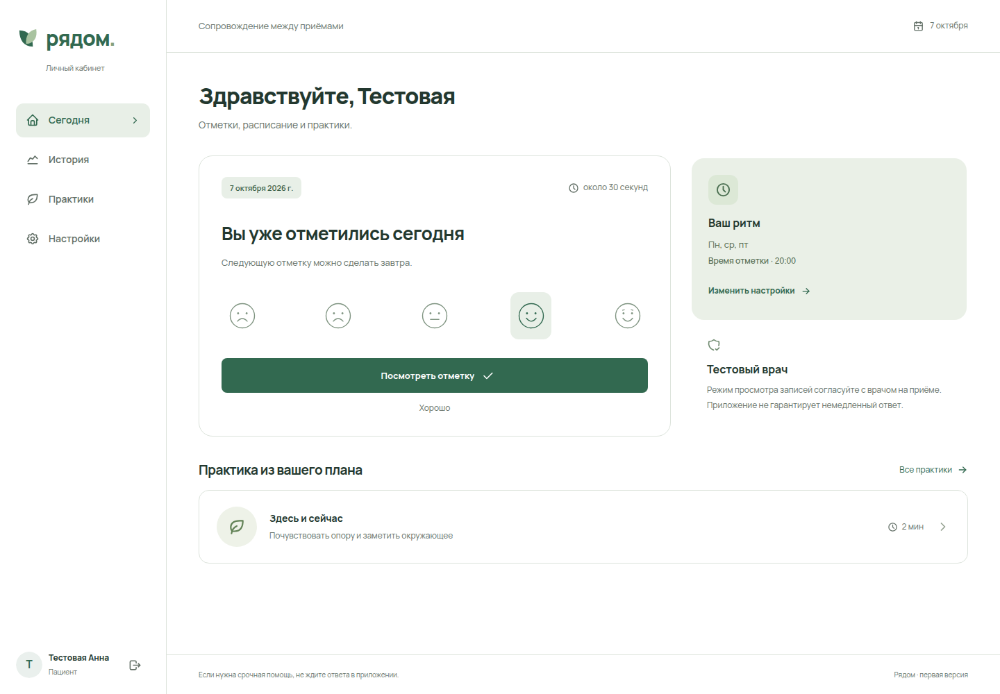
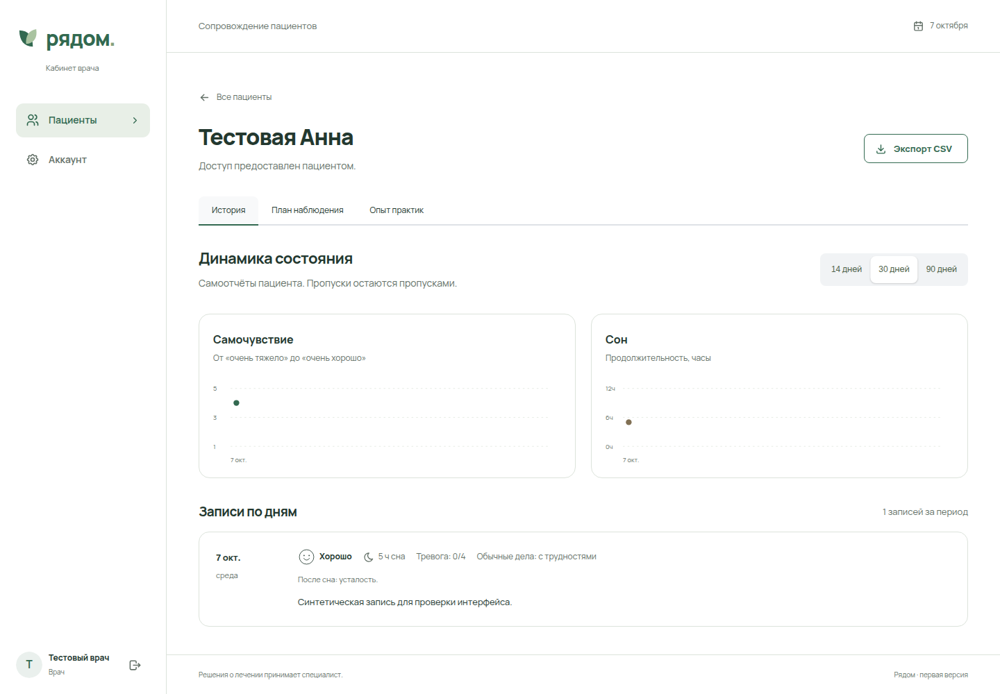
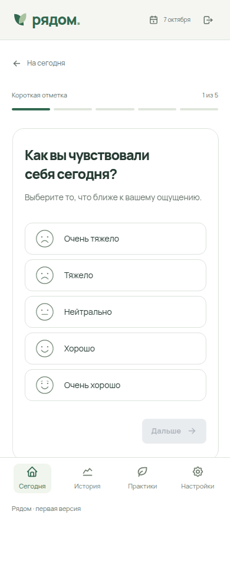
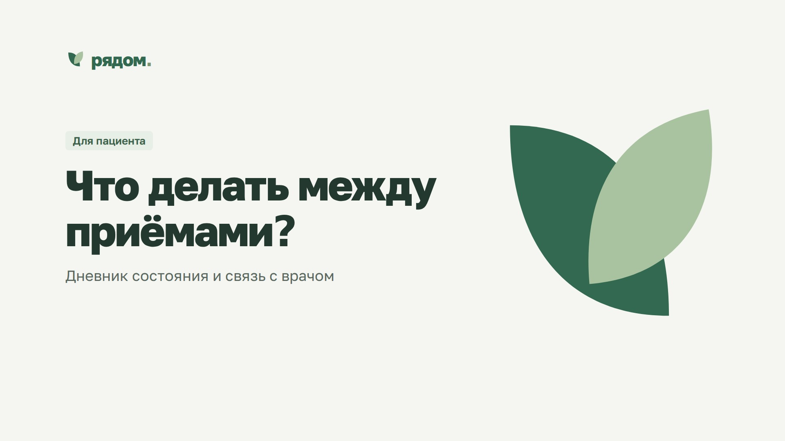

# Рядом

Рядом is a web app that keeps a patient and their doctor in touch between appointments. The patient marks how the day went in a check-in that takes a minute, does the short practices their doctor prescribed, and sends a summary before the next session. The doctor opens the summary, sees what changed, and changes the plan while the therapy is still running.



[](LICENSE)
[](https://github.com/aa-blinov/doktor-ryadom/actions/workflows/ci.yml)

---

## Quick start

```bash
docker compose up -d --build
```

Node 22, one container, SQLite on a named volume. The app listens on port 3000 inside the container and is reached through the Caddy reverse proxy on the host: `compose.yml` puts it on the `edge` network at `172.40.0.30`. The domain in use is `doktor-ryadom.duckdns.org`, and `deploy/README.md` holds the Caddy block and the deployment steps.

To work on the code, run it from `app/` instead:

```bash
npm ci
npm run db:migrate   # apply app/drizzle/*.sql to the local D1
npm run dev:server   # Wrangler on http://localhost:8787
npm run dev          # Vite, proxying /api to Wrangler, in a second terminal
```

## What it does

- **A check-in a day.** Mood on a five-point scale, hours of sleep, anxiety, energy, how ordinary things go, and a note when there is one worth writing. The extra questions can be skipped, and an unfinished day is kept as a draft.
- **A plan the doctor writes.** What to track, how often (every day, three times a week, once a week), which practices, and how to get in touch. The patient sees the current version of it.
- **Twelve short practices.** One to three minutes each, adapted from WHO and NHS material, each with its source and its method note, and a step that can be left at any point. A doctor can write their own, with their own steps, photo and video.
- **Questionnaires with a method note.** PHQ-2, PHQ-9, GAD-7 and WHO-5 in the public-domain Russian wording, plus questionnaires the doctor writes. A standard one carries its own score, a custom one carries none, and the app never adds the two together.
- **A summary before the session.** The patient picks a period and sends the entries, the practice feedback, the questionnaire answers, the goals and the medication log. The doctor reads it and confirms the review, and the patient sees that it was read.
- **Goals.** Three at a time, with a mark for a step taken, a difficulty, or a goal reached. No score.
- **A distress signal.** One tap, and every doctor the patient is connected to gets a push and an email, whatever the patient's own reminder settings are. The screen also says to call 112 when it is an emergency.
- **A card the doctor writes in.** Visit summary, diagnosis, treatment, referral. An entry is withdrawn with a reason, never erased.
- **A directory of specialists and a calendar of slots.** A catalogue of verified specialists, one review per patient, the next free slot on the card, and a request that expires after 24 hours.
- **Your data leaves with you.** Export as JSON or as a zip with the photos, video and documents, and delete the account.

## Screenshots

| The doctor's overview | A questionnaire |
| :---: | :---: |
|  |  |

The two demo videos in `demo/` tell the same story from both sides: three weeks between two sessions, and what each side has to work with.

| Doctor demo | Patient demo |
| :---: | :---: |
|  |  |

Every account and every record in the screenshots was made by the browser test, and the names in the videos are invented.

## How it works

```
browser (React, Mantine, PWA)
  -> /api  (Hono, one app)
  -> SQLite (one file)
```

The client is a Vite app: React 19, Mantine 8, and a service worker that caches the shell and the static assets. The API is never cached, and clinical records are not kept in `localStorage`.

The API is a single Hono app in `app/server/index.ts`, written against a D1 binding. It runs on two adapters:

- Cloudflare D1, for the Worker build.
- `node:sqlite`, wrapped in the same interface by `app/server/sqlite.ts`, for the Docker build.

The migrations in `app/drizzle/` are plain SQL applied in order. The Node runner keeps a SHA-256 checksum of every file it has applied and refuses to start when one of them has changed, so a migration that has run never changes afterwards.

Sessions are cookies. The token is random, the cookie is HttpOnly and SameSite=Lax, and the database holds only the SHA-256 digest of the token. Writes must carry a matching `Origin` header, the body limit is set per route, and only the routes listed in `app/server/upload-limits.ts` may carry a file.

In the Node build a minute job delivers the notifications and the reminders, a 15-second job sweeps the appointment reminders, and the day ends with a backup of the database.

## Configuration

| Variable | Default | What it does |
| --- | --- | --- |
| `PORT` | `3000` | The port the Node server listens on. |
| `PUBLIC_ORIGIN` | `http://localhost:3000` | The public origin. The Origin check and the secure cookie flag read it. |
| `DATABASE_PATH` | `data/ryadom.sqlite` | The SQLite file. In Compose it is `/data/ryadom.sqlite`. |
| `CLIENT_DIR` | `dist/client` | Where the built client is read from. |
| `SMTP_HOST` | none | The SMTP server. Without it the app sends no email at all. |
| `SMTP_PORT` | `465` | The SMTP port. |
| `SMTP_SECURE` | `true` | TLS from the first byte. `false` asks for STARTTLS instead. |
| `SMTP_USER`, `SMTP_PASSWORD` | none | The SMTP credentials. |
| `RESEND_API_KEY` | none | Sends mail through Resend instead of SMTP. |
| `MAIL_FROM` | none | The sender. Mail needs it, and the interface hides the send button without it. |
| `VAPID_SUBJECT` | the public origin | The contact address in the web push keys. |
| `RYADOM_EDGE_IP` | `172.40.0.30` | The address the container takes on the `edge` network. |

The off-site service reads its own secrets from `.env.offsite`: `S3_ENDPOINT`, `S3_REGION`, `S3_BUCKET`, `S3_KEY_ID`, `S3_SECRET_KEY`, and `BACKUP_ENCRYPTION_KEY`, which is 32 random bytes in base64. The bucket only ever holds ciphertext, and losing the encryption key means losing the copies.

The settings a patient controls live in the database rather than in the environment: the reminder at 20:00, the time zone `Asia/Almaty`, a check-in every day, and the reminder channels off except for visit notifications.

## Development

```bash
cd app
npm ci               # install
npm run check        # tsc --noEmit
npm test             # vitest
npm run build        # typecheck, client build, worker bundle
npm run build:docker # the same, plus the Node bundle for the container
```

`node scripts/integration.mjs` runs an end-to-end pass over HTTP and needs a running Wrangler. It creates synthetic accounts only.

The demo videos are rebuilt from `demo/build_demos.py`, rendered with Hyperframes and finished with `demo/finish.sh`:

```bash
cd demo
python3 build_demos.py .
cd doctor/composition && npx hyperframes@0.8.161 check && npx hyperframes@0.8.161 render --quality looks --output ../video.raw.mp4
cd ../../patient/composition && npx hyperframes@0.8.161 check && npx hyperframes@0.8.161 render --quality looks --output ../video.raw.mp4
node posters.mjs
./finish.sh
```

| Path | What it holds |
| --- | --- |
| `app/src/` | The React client. One file per screen. |
| `app/server/` | The Hono API. |
| `app/server/index.ts` | The routes, the session check, the role checks, the body limits. |
| `app/server/node.ts` | The Node adapter for Docker: `node:http`, `node:sqlite`, the static files, the background jobs. |
| `app/server/sqlite.ts` | The D1-shaped adapter over `node:sqlite`, and the migration runner. |
| `app/db/schema.ts` | The Drizzle schema. |
| `app/drizzle/` | The migrations, plain SQL, applied in order. |
| `app/tests/` | The vitest suite and the Playwright browser scenarios. |
| `app/scripts/` | Backup, off-site, admin, verification and integration scripts. |
| `demo/` | The two demo videos, their sources, the transcripts and the poster build. |
| `deploy/` | The Caddy fragment and the script that adds it to the shared Caddyfile. |
| `docs/` | The methodology per screen, the reviews, the QA notes, the screenshots. |

## License

[MIT](LICENSE), © Alexander Blinov.
