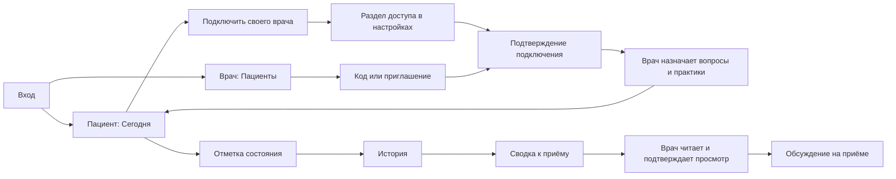

# Как работает «Рядом»

«Рядом» — дневник состояния пациента для наблюдения вместе с врачом и подготовки к приёму.

## Для пациента

Сохраните самочувствие, сон и важные события. По записям проще вспомнить, что менялось, и что хочется обсудить. Дневник можно начать до подключения врача.

На странице «Сегодня» подключение врача расположено перед настройкой расписания. Видно следующее действие: сделать отметку, продолжить черновик или открыть уже сохранённую запись. Кнопка «К приёму» открывает сводку за выбранный период. Отправленная сводка появляется у врача; после его подтверждения виден статус просмотра.

Опросники и практики назначает врач. Ежедневная отметка — запись в дневнике; стандартные опросники — отдельные формы с собственным расчётом баллов. У каждого есть описание и источник. Результаты не складываются в единый показатель.

Личные цели пациент формулирует сам: можно сохранить небольшой шаг, трудность или достижение. Эти отметки не имеют баллов. В конце практики можно пояснить, что помогло или помешало; врач подтверждает просмотр отзыва и обсуждает, как изменить план.

## Подключение врача

Попросите у своего врача код или ссылку. На странице «Сегодня» нажмите «Подключить врача»: откроется нужный раздел настроек. Проверьте профиль специалиста и подтвердите подключение. Это подключение к знакомому врачу, а не подбор врача сервисом.

Доступ к записям и его отзыв описаны в настройках. Согласуйте с врачом порядок просмотра записей и способ связи при ухудшении; приложение не обещает постоянного наблюдения или мгновенного ответа.

## Для врача

Передайте пациенту свой код или приглашение. После подключения выберите вопросы, частоту отметок и практики. Укажите порядок просмотра записей.

В списке пациентов видны новые материалы. Перед приёмом откройте сводку, заметки и исходные ответы; затем изучите динамику за нужный период. Отметка «просмотрено» показывает пациенту, что вы прочитали сводку, но не заменяет беседу и рекомендации.

Карточка пациента открывается обзором после последних сохранённых рекомендаций или за 14 дней. В нём показаны факты дневника, сравнение сна с предыдущим периодом и отдельные переходы к непросмотренным материалам. Отзывы о практиках и продвижение к целям входят в очередь вместе со сводками и опросниками. Порядок просмотра остаётся согласованным со специалистом.

## Основные переходы

## Что важно объяснить на экранах

Первый экран называет дневник, участие врача и цель записей. Пациенту показывается конкретное действие на сегодня; врачу — материалы, которые нужно просмотреть. Подключение ведёт прямо к нужному разделу. Участие врача объясняется без обещания круглосуточного наблюдения. Условия доступа остаются в настройках.
