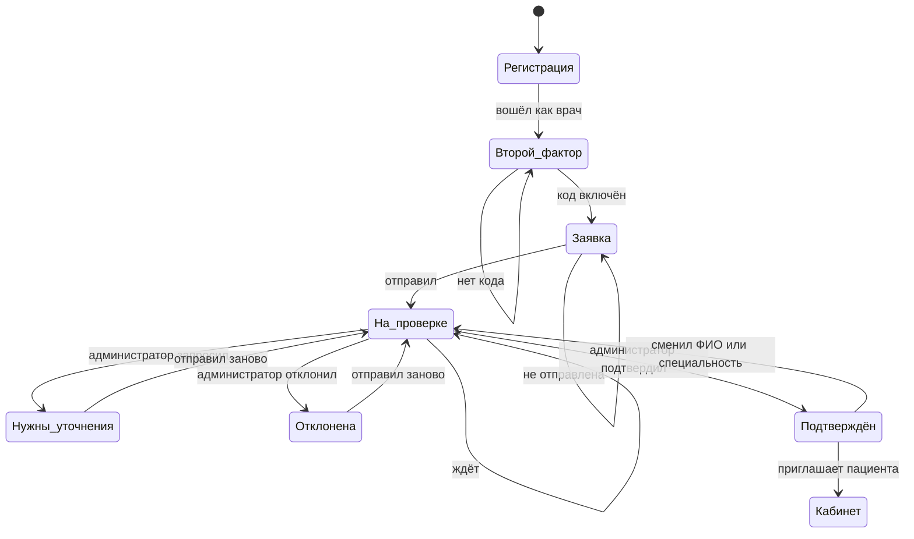
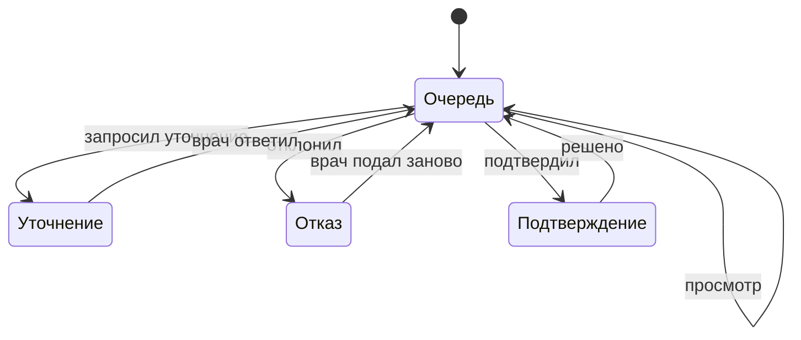
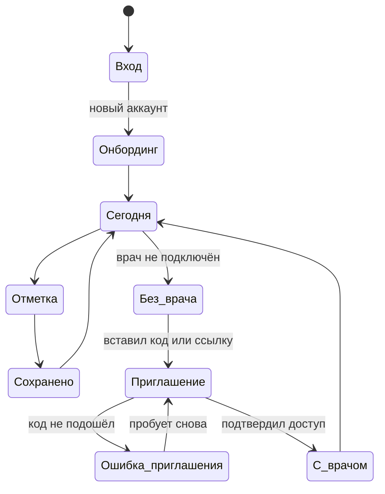
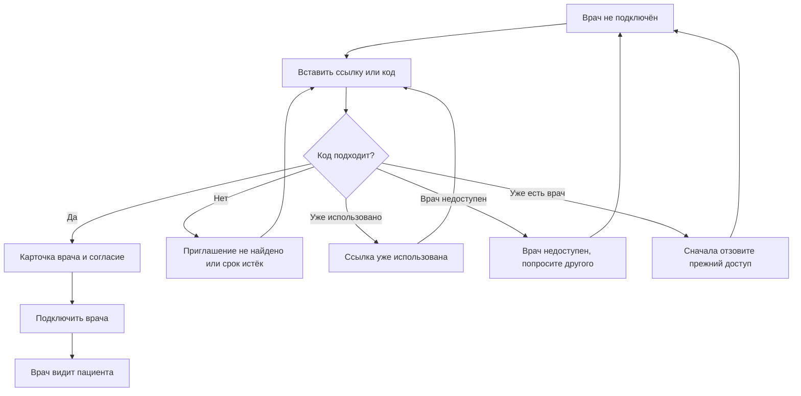

# Маршруты по ролям и состояния

Документ описывает, что видит человек в каждом состоянии, куда его ведёт
приложение и что он должен понять из того, что видит. Схемы показывают
переходы, текст под ними — точный смысл каждого состояния.

Документ отвечает на вопрос «всё ли в моменте ясно?» и не отвечает на
вопрос «правильно ли устроена клиника». Формулировки вопросов и практик
остаются предметом согласия с психиатром, см.
[review/clinical-wording.md](review/clinical-wording.md).

## Правило, из которого выведены все маршруты

У каждого состояния четыре признака:

1. **Где я.** Заголовок экрана и раздел навигации называют текущее место.
2. **Что произошло.** Экран говорит, что случилось, а не молчит.
3. **Что делать дальше.** Есть действие, ведущее к следующему шагу.
4. **Что приложение обещает.** Обещание соответствует тому, что делает
   сервер. Расхождение здесь — самый дорогой вид дефекта: человек действует
   в расчёте на обещанное и ждёт того, чего не будет.

Четвёртый пункт проверяется по коду, а не по впечатлению от экрана.

---

## Врач: путь от регистрации до первого пациента

Это самый длинный маршрут в приложении, и он проходит через четыре
состояния, каждое из которых закрывает предыдущее.

### Регистрация

Экран входа предлагает выбор роли: пациент или врач. Врач выбирает роль и
попадает на настройку второго фактора. Дальше путь одинаковый для врача и
администратора, потому что у обоих есть доступ к записям пациентов.

### Второй фактор

Экран «Включите вход с кодом» заменяет собой все остальные разделы: пока
код не включён, навигация остаётся видимой, но серым, и любой её пункт
возвращает на этот же экран.

Обещание экрана — «Настройте его здесь, затем кабинет откроется» — точно
для администратора и для подтверждённого врача. Для врача, который ещё не
прошёл проверку, кабинет останется закрытым до решения администратора, и
это написано на экране заявки.

### Заявка

Форма «Подключение врача» содержит тип специалиста, специальность, номер
лицензии или диплома, город и необязательный контакт. Контакт — это телефон
или ник в мессенджере: он нужен администратору, чтобы договориться о
проверке, когда по заявке есть вопрос, и он не публикуется пациентам.

Пока заявка не подана, видны все поля. После отправки форма исчезает, и
остаётся блок «Заявка на проверке».

### На проверке

Врач видит:

- в боковой панели ярлык «На проверке»;
- в меню «Подключение» вместо «Пациенты»;
- «Практики» и «Расписание» видимыми, но серыми, с подсказкой «Откроется
  после подтверждения профиля»;
- на экране заявки блок «Заявка на проверке. Мы проверим данные и сообщим
  результат. Пока заполните профиль: так пациентам будет проще вас узнать».

Кабинет при этом закрыт на уровне сервера: все маршруты `/api/doctor/*`,
кроме самой заявки, отвечают 403 «Кабинет врача открыт после проверки
администратором». Интерфейс и сервер говорят одно и то же.

Чего экран не говорит: сколько ждать и где придёт результат. Результат
приходит в уведомления приложения и на почту, если почта подтверждена.
Поэтому в заявке есть строка про неподтверждённую почту — она объясняет
администратору, что врач узнает о решении только из приложения.

### Нужны уточнения и отказ

Оба состояния показывают комментарий администратора и предзаполненную
форму. Разница — в цвете и в формулировке: жёлтый блок «Нужны уточнения»
или красный «Заявка отклонена». В обоих случаях кнопка «Отправить заявку
снова» возвращает заявку в работу, поэтому отказ не оставляет врача без
выхода.

### Подтверждение

После решения врач видит блок «Профиль подтверждён. Можно приглашать
пациентов» и кнопку «К пациентам». Если пациенты не появились, экран прямо
просит обновить страницу: решение принимает администратор, а факт
подтверждения клиент узнаёт при следующем запросе.

### Повторная проверка после смены ФИО

Смена ФИО или специальности снимает подтверждение: это правило сервера,
оно не оставляет подтверждённым профиль с новым именем. Заявка при этом
остаётся в состоянии «одобрена», поэтому врач должен увидеть отдельное
состояние — «Нужна повторная проверка» — с формой для новой заявки.

---

## Администратор: очередь заявок

Очередь показывает только последнюю заявку каждого врача: после отказа
новая заявка закрывает старую, и в очереди не копится история.

В карточке заявки администратор видит:

- имя, почту, дату подачи;
- **признак подтверждения почты**: если адрес не подтверждён, рядом стоит
  строка о том, что решение придёт только во входящие приложения;
- тип специалиста, специальность, город;
- номер лицензии или диплома;
- **контакт врача** — телефон или мессенджер, если он его оставил;
- комментарий врача.

Решение доступно как «Подтвердить», «Запросить уточнение» и «Отклонить».
Для уточнения и отказа обязателен комментарий: администратор должен
написать врачу, что именно нужно исправить.

Кнопка «Подтвердить» заблокирована, если в заявке не указан тип
специалиста. Подсказка под ней предлагает попросить врача указать тип и
подать заявку снова — это единственный путь, потому что тип выбирает сам
врач, а администратор назначает его только уже подтверждённому специалисту.

---

## Пациент: первый вход и подключение врача

### Приглашение и его ошибки

Экран «Врач» в настройках принимает ссылку или код приглашения. Сервер
различает шесть исходов: приглашение не найдено, срок истёк, ссылка уже
использована, врач недоступен, врач заблокирован, у пациента уже есть
врач.

Каждому исходу соответствует своя строка в интерфейсе, и все они видны
на вкладке «Врач». Это правило проверяется прямо: если ошибка нарисована
только на одной вкладке настроек, пациент с неверной ссылкой видит
молчание вместо ответа.

### Ошибка сохранения отметки

Отметка за сегодня уже сохранена — экран объясняет это и предлагает
открыть историю. Ошибка приходит с сервера и показывается как есть.

---

## Что в этой версии исправлено

| Что было | Что стало | Где |
|---|---|---|
| Ошибка приглашения не показывалась: блоки сообщений лежали внутри вкладки «Напоминания» | Сообщения вынесены наружу и видны на всех вкладках настроек | `app/src/Patient.tsx` |
| Пациенту показывалось «назначивший врач больше не имеет доступа» при подключённом враче | Врач передаётся в список опросников, и текст соответствует реальности | `app/src/Patient.tsx` |
| «Врач получит его на почту и в уведомления» — обещание без гарантии | Текст говорит, что сигнал дойдёт, если у врача есть подтверждённая почта или уведомления на устройстве | `app/src/Patient.tsx` |
| Сигнал помечался доставленным, даже когда ни один канал не сработал | Отметка о доставке ставится только после реальной передачи | `app/server/jobs.ts` |
| Администратор не видел, подтверждена ли почта врача | В карточке заявки есть строка о неподтверждённой почте | `app/src/AdminVerifications.tsx` |
| Подсказка «укажите тип в разделе „Врачи“» вела в тупик: сервер отказывает неподтверждённому | Подсказка предлагает попросить врача указать тип | `app/src/AdminVerifications.tsx` |
| После смены ФИО врач видел «Профиль подтверждён» при закрытом кабинете и не мог подать заявку | Появилось состояние «Нужна повторная проверка» с формой | `app/src/DoctorVerification.tsx` |
| Связаться с врачам было нечем | В заявке есть поле контакта, администратор видит его в карточке | `app/src/DoctorVerification.tsx` |
| Уведомление администратору о новой заявке вело в список врачей, а не в очередь заявок | Ссылка ведёт в раздел «Заявки», где стоят кнопки решения | `app/server/verification.ts` |
| Уведомление врачу об отказе вело в профиль, где нет комментария администратора | Ссылка ведёт в раздел «Подключение», где комментарий и находится | `app/server/verification.ts` |

## Правило для уведомлений

Уведомление должно приводить туда, где человек может действовать, а текст
и ссылка должны называть одно и то же место. Проверяется это просто: у
каждого уведомления есть цель и надпись, и если надпись говорит «откройте
раздел», то ссылка ведёт в этот раздел.

| Уведомление | Куда ведёт |
|---|---|
| Администратору: новая заявка на проверку | `/admin`, раздел «Заявки» |
| Врачу: решение по заявке | `/patients`, раздел «Подключение» |
| Врачу: пациент принял приглашение | `/patients`, список пациентов |
| Врачу: сигнал «Мне сейчас плохо» | `/patients`, список пациентов |
| Пациенту: врач добавил запись в карточку | `/card`, карточка |
| Пациенту: врач больше не ведёт | `/today`, главный экран |

---

## Что осталось открытым

Эти находы не исправлены: они требуют решения продукта или клинического
согласования, а не правки текста.

1. **Частота напоминаний задаётся врачом и не видна пациенту.** При плане
   «раз в неделю» пациент ждёт ежедневное напоминание и шесть дней видит
   тишину без объяснения.
2. **«Динамика: Ухудшение» показывается без пояснения.** Причина динамики
   врачебная и пациенту не показывается, но сама метка остаётся.
3. **Согласие недооценивает объём доступа врача.** В тексте «предыдущие
   рекомендации», а врач видит полную запись приёма, включая жалобы,
   осмотр и диагноз. Формулировку нужно согласовать с юристом.
4. **Пустое состояние опросников недостижимо.** Текст «Врач пока не
   назначил опросники» не появляется, потому что раздел скрывается раньше.
5. **Оценка риска и балл в интерфейсе пациента.** Сейчас уровень риска не
   называется, и это правильно. Любое появление формулировки о риске
   требует психиатра.

## Что сделано намеренно

Эти вещи выглядят как пробелы, но это решения, и менять их без причины
не нужно.

- **Меню пациента состоит из пяти пунктов:** Сегодня, Практики, История,
  Врач, Настройки. Экраны «Цели» и «План врача» в меню не стоят, а
  открываются по смыслу: из истории и из опросника. Так нижняя панель
  остаётся на пяти пунктах, а не растёт (см. `DESIGN.md`).
- **Врач не видит пациентов, пока не подтверждён.** Это не ошибка и не
  задержка: проверка квалификации стоит перед доступом к записям.
- **Врач выбирает тип специалиста сам.** Назначать его задним числом
  значило бы передать врачу полномочия назначать препараты, о которых он не
  просил.
