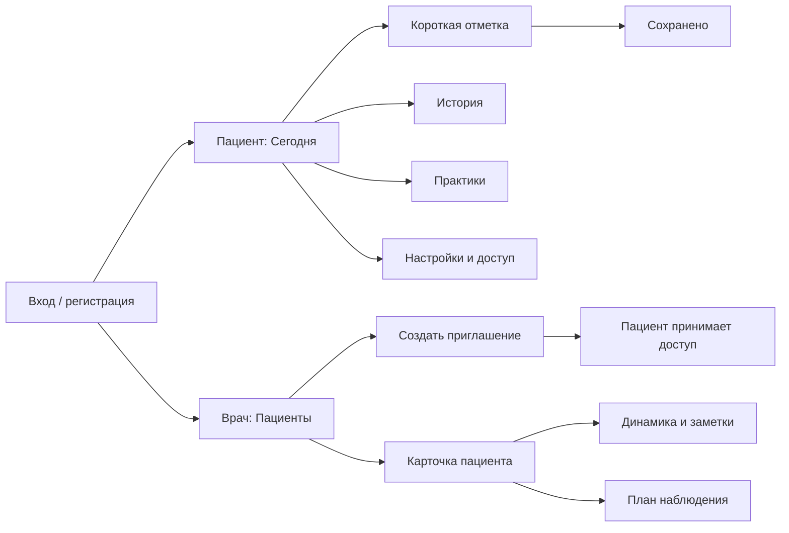

# Рядом: экраны и сценарии

[Методика по каждому экрану, вопросы и практики](METHODOLOGY.md).

## Цель первой сборки
Работающий PWA с регистрацией и серверным хранением. Пациент отмечает состояние; врач просматривает только записи пациентов, принявших приглашение. Все примеры практик и правила наблюдения требуют клинического согласования.

## Карта экранов

## Пациент
- **Сегодня:** статус текущей отметки, дата, одна кнопка действия, необязательная практика, конкретный режим просмотра врачом. При отсутствии связи: возможность принять приглашение.
- **Отметка:** один вопрос за раз; самочувствие обязательно, сон и выбранные врачом показатели можно пропустить; заметка необязательна. Для короткого сна: одно пояснение про усталость/энергию. Назад не теряет ответы. После сохранения: подтверждение и переход в историю.
- **История:** отдельные графики сна и самочувствия, список записей с точными датами, заметки; пропуски не интерполируются. Пустой экран предлагает первую отметку.
- **Практики:** библиотека из 12 упражнений с поиском и фильтрами, пошаговое выполнение, остановка без обязательного завершения. После: оценка переносимости. Неприятная практика перестаёт предлагаться, пока пациент не включит её снова.
- **Настройки:** расписание отметки внутри приложения, пауза, принятый доступ врача и отзыв с объяснением последствий.

## Врач
- **Пациенты:** поиск по имени; дата последней записи; последнее самочувствие и число записей. Пустой экран: создание приглашения.
- **Приглашение:** одноразовая ссылка, ограниченный срок действия, копирование; создаёт связь только после согласия пациента.
- **Карточка:** динамика за выбранный период, сырые записи, заметки, переносимость практик, CSV. Недоступность после отзыва согласия.
- **План:** частота, дополнительные показатели, выбранные практики, одна привычка, текст о режиме просмотра. Настройки сохраняются на сервере.

## Общие правила UX
- Мобильная нижняя навигация, настольная боковая; одинаковые названия разделов.
- Крупные зоны нажатия от 44 px, видимый клавиатурный фокус, подписанные поля и состояния, текстовые альтернативы графикам.
- Ошибка загрузки: повторить. Ошибка сохранения: сохранить ввод, повторить запрос. Отправка блокирует повторное нажатие.
- Нет стриков, красных оценок настроения, диагнозов, автоматического назначения лечения или обещания круглосуточного мониторинга.
- Фоновые уведомления, проверка статуса врача, подтверждение email и восстановление пароля: следующий этап. Первая сборка не выдаётся за готовую медицинскую систему.

## Цели и обзор для пилота

Пациент открывает «Мои цели» со страницы «Сегодня», добавляет цель и необязательное объяснение, затем сохраняет шаг, трудность или достижение. После сохранения форма сворачивается: на экране остаются цель и запись. Завершение цели сохраняет историю.

Карточка пациента у врача начинается с «Обзора»: последняя заметка, четыре факта дневника после последних рекомендаций или за 14 дней, затем переходы к истории и рекомендациям. Кнопки новых материалов показываются только при ненулевом числе. Сравнение сна, пояснения расчётов и отметки о препаратах доступны в раскрываемых подробностях. Во вкладке «Цели» доступны исходные отметки и подтверждение просмотра. Во вкладке «Опыт практик» — оценки, пояснения и подтверждение чтения. Корректировка задания остаётся в плане наблюдения или рекомендациях после приёма. При возвращении в список пациентов очередь обновляется; переходы пациента также обновляют данные.

Правила расчёта и ограничения описаны в [методике целей](methodology/goals.md), сценарий проверки пользы — в [плане пилота](PILOT.md).

## Уточнение сводки и загрузки, 8 октября 2026

В истории врача графики тревоги, энергии и обычных дел видны сразу; у пациента они остаются в необязательном раскрываемом блоке. Положительный пункт 9 PHQ-9 сохраняет отдельное сообщение над основными фактами обзора. В сводке исходные ответы, цели, лечение и опыт практик раскрываются по запросу; при печати подробности открываются автоматически, затем восстанавливается прежнее состояние. Разделители кратких фактов в интерфейсе заменены запятыми.

Вкладки врача впервые загружаются при открытии и сохраняют введённые значения при возвращении. Состояние разделено по пациентам. Запрос списка пациентов выполняется на маршруте списка, а библиотека опросов — при открытии соответствующей вкладки. API ограничивает ожидание ответа и чтение тела 20 секундами, без автоматических повторов. После тайм-аута сохранения следует обновить страницу и проверить результат, прежде чем отправлять повторно. Локальные измерения и их ограничения: [PERFORMANCE.md](PERFORMANCE.md).

## Меню карточки и верхняя панель, 8 октября 2026

При ширине до 680 px восемь разделов карточки врача выбираются через подписанное нативное меню «Раздел карточки пациента». На большей ширине остаются вкладки. Меню и вкладки используют один выбранный раздел; переход из обзора обновляет значение меню. При смене ширины сохраняются раздел и ввод в уже открытых формах. Меню не печатается.

При ширине до 900 px верхняя панель обоих кабинетов остаётся у верхнего края при прокрутке. Её непрозрачный фон соответствует теме; для полей и действий предусмотрен отступ прокрутки 84 px. На настольном экране панель остаётся в обычном потоке.

[Разбор сценария врача](CLINICIAN-AUDIT.md) выполнен до этой правки. Меню упрощает выбор раздела; замечания к очереди наблюдений, переходу к результату PHQ-9, периоду обзора и различению текущих данных и снимка остаются открытыми.

## Сводка в PDF, 8 октября 2026

В разделе «К приёму» кнопка «Скачать PDF» сохраняет файл `ryadom-report-YYYY-MM-DD.pdf`, где дата — последний день выбранного периода. Для текущей сводки доступны 14 или 30 дней; у отправленной версии используются её сохранённые даты и записи. Старый TXT-экспорт сводки заменён PDF. Кнопка «Печать» отдельно открывает диалог браузера.

Документ A4 начинается с имени пациента, точного периода и краткой сводки, затем идут заметки с датами и исходные ответы по дням. Заполненные разделы опросников с исходными ответами и методикой, назначений, ощущений и событий, целей, рекомендаций после приёма и опыта практик следуют ниже. Пропуски остаются пропусками; общая диагностическая оценка не рассчитывается. Отправленный снимок не дополняется более поздними текущими записями.

PDF сохраняет оформление спокойного дневника: Manrope, зелёные заголовки, тонкие разделители, светлая повторяющаяся шапка, белые поля и период с номером страницы внизу. Текст можно выделять. На узком экране загрузка представлена иконкой с доступным именем «Скачать PDF». При создании файла кнопка показывает загрузку и блокирует повторное нажатие; при ошибке можно повторить попытку. Отправка врачу остаётся отдельным действием. PDF формируется в браузере с локальными ресурсами шрифта; данные пациента не загружаются во внешний сервис.

[Проверки и ограничения PDF](VALIDATION.md#сводка-в-pdf-8-октября-2026).

## Карточки практик, возврат к разделу и адрес врача, 8 октября 2026

Библиотека показывает отдельные плоские карточки: две колонки на настольном экране, одна на мобильном. Между карточками 24 px; рамка 1 px, скругление 16 px, внутренние отступы 24 px (20 px на мобильном). У каждой практики остаётся собственная иллюстрация. Направление и длительность подписаны текстом без повторяющихся значков листа и часов; длительность в рекомендациях на странице «Сегодня» также без значка.

Каждый раздел меню возвращается к своей позиции прокрутки окна. Память разделена по аккаунту и маршруту, а в карточке врача — дополнительно по пациенту и вкладке; для каждой карточки пациента врач возвращается к последней открытой вкладке. Практики и записи дневника имеют устойчивые якоря со смещением. Разделы без такого якоря используют сохранённую числовую позицию; первое открытие начинается сверху. Память работает в текущем приложении и, если доступно sessionStorage, в пределах сеанса вкладки браузера. Поздняя загрузка содержимого уточняет положение до 20 секунд; действие пользователя прекращает автоматическое восстановление.

В профиле врача есть отдельное необязательное многострочное поле полного адреса, до 500 символов. Сохранённый адрес виден подключённому пациенту. Название клиники и прежний текст «Коротко о себе» остаются самостоятельными полями. Отсутствие адреса в запросе старого клиента сохраняет ранее записанное значение.
