# Переходы пользователя в «Рядом»

Диаграммы отражают текущие экраны и действия. Передача врачу означает отправку сводки перед приёмом в его кабинет. Email и push при отправке не используются.

## Пациент: первый вход и ежедневная отметка

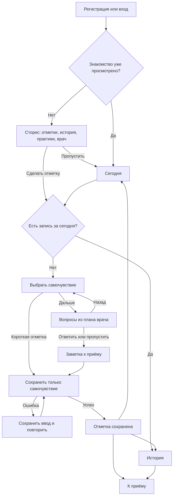

По умолчанию расписание ежедневное. Сохранённый врачом план может задавать другую частоту. Самочувствие обязательно, остальные ответы допускают пропуск. Одна запись за дату; повторное открытие опроса после сохранения ведёт к истории.

## Отправка сводки и просмотр врачом

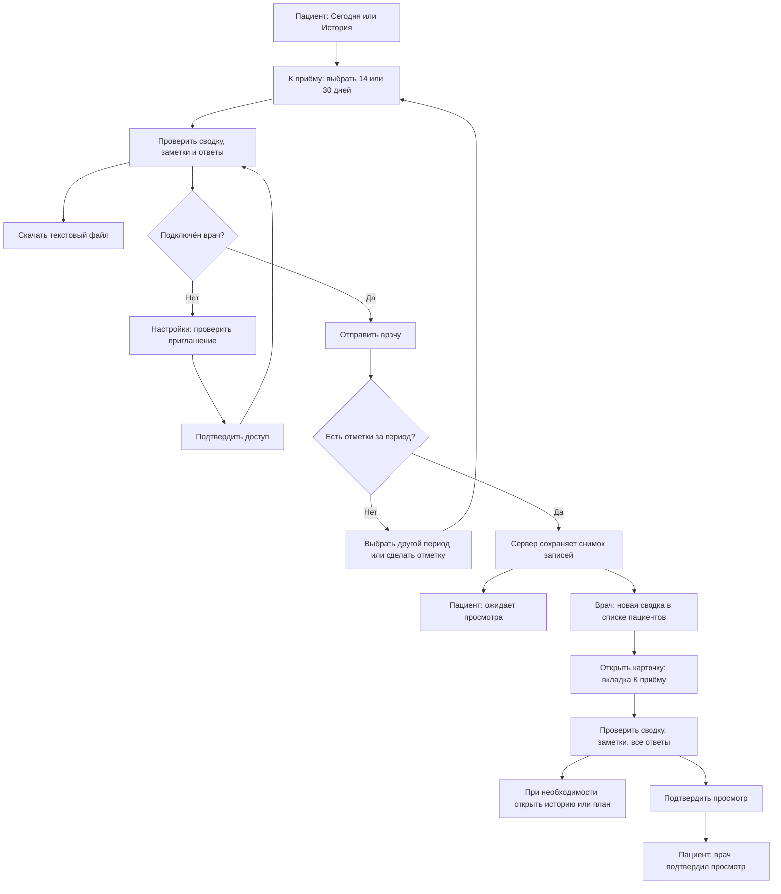

Повторная отправка того же снимка не создаёт дубликат. Подтверждение просмотра относится к конкретной сводке. Оно не означает медицинского заключения или ответа пациенту. После отзыва доступа врач не может открыть сводку и подтвердить просмотр, даже если раньше её получил.

## Практики

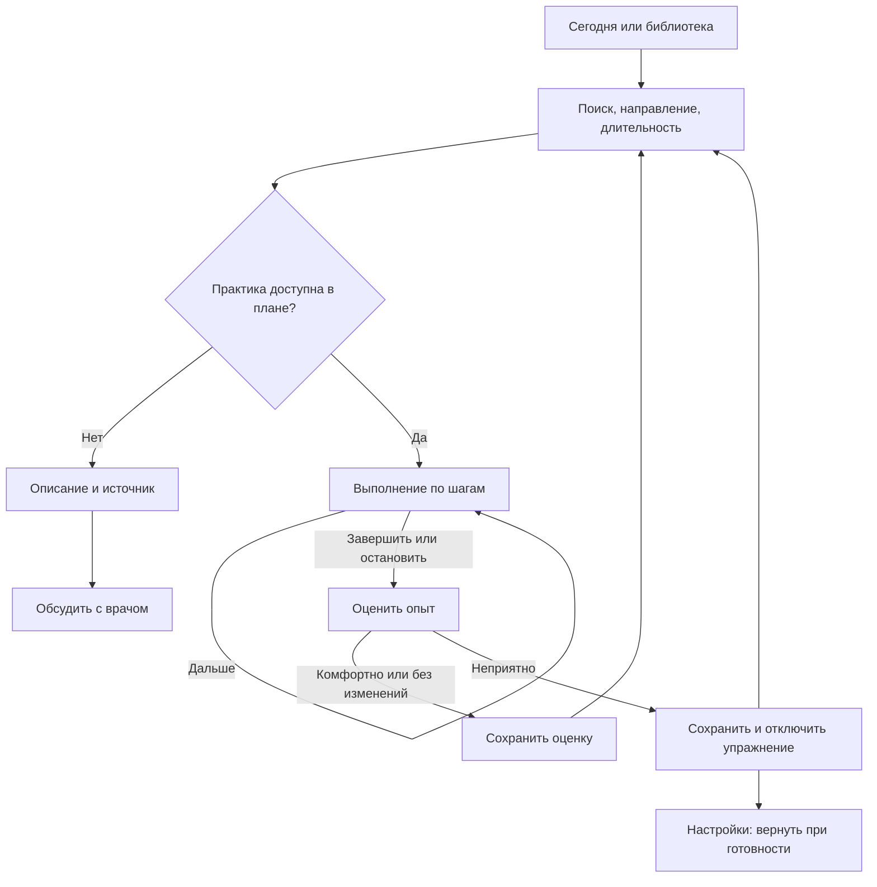

## Врач: подключение и план

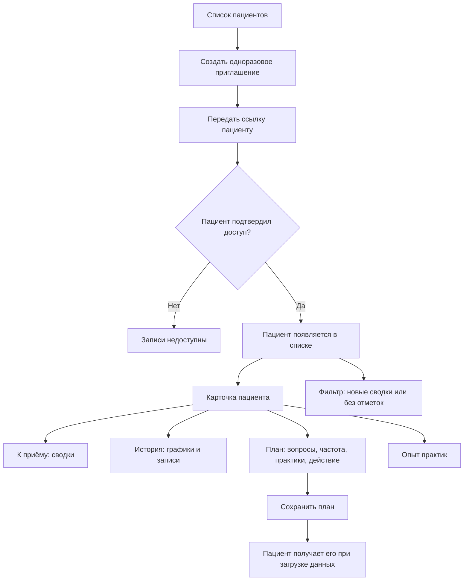

## Врач: проверка квалификации

Кабинет закрыт до решения администратора, поэтому этот маршрут идёт
раньше предыдущего. Подробное описание состояний — в
[ROLE-FLOWS.md](ROLE-FLOWS.md).

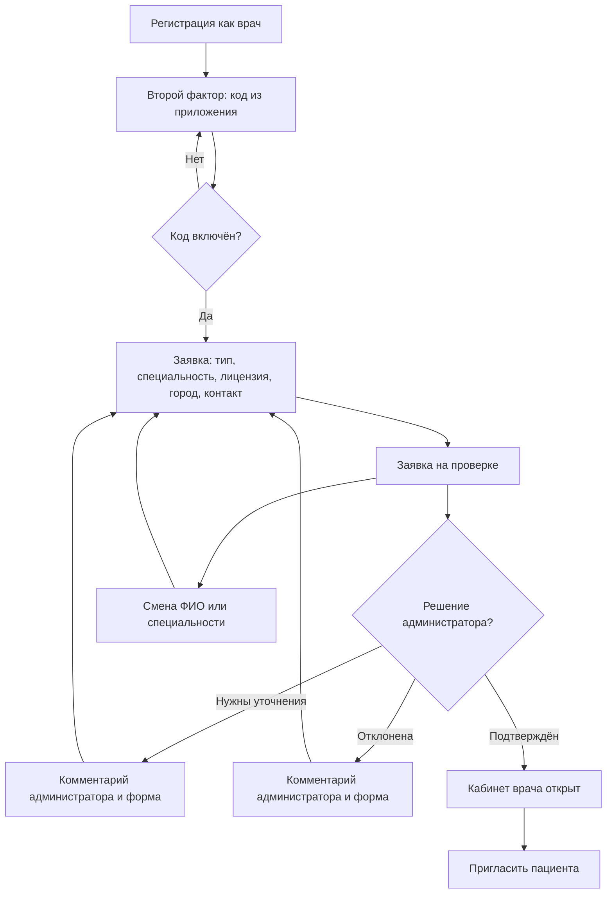

Администратор принимает решение в очереди заявок. Он видит почту врача,
признак того, что она подтверждена, и контакт, если врач его оставил.

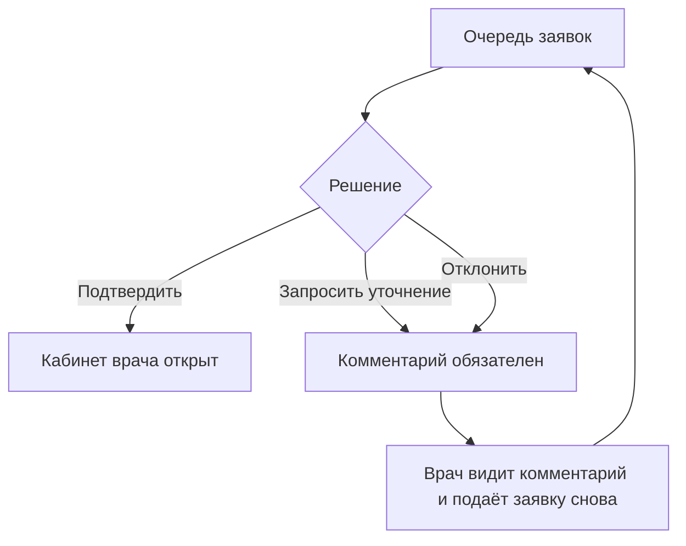

## Состояния, которые проверяет QA

| Ситуация | Ожидаемое поведение |
|---|---|
| Сторис пропущены | Открывается кабинет; просмотр можно повторить в настройках |
| Сегодня уже есть отметка | Вторую форму не предлагают; запись доступна в истории |
| У пациента мало сил на опрос | Можно сохранить только самочувствие |
| Дополнительный ответ пропущен | Хранится отсутствие ответа; сводка не подставляет ноль |
| Нет врача или отметок за период | Отправка недоступна с пояснением; предложен следующий шаг |
| Повторное нажатие или повтор запроса | Один снимок сводки, без дублей |
| Позже появились новые записи | Уже отправленная сводка остаётся неизменной |
| Другой врач пытается открыть сводку | Сервер отклоняет запрос |
| Пациент отозвал доступ | Врач больше не может просматривать данные или подтверждать сводку |
| Оценка практики неприятная | Упражнение отключается; опыт остаётся в истории |
| Ошибка сохранения | Введённые ответы остаются в открытой форме |

Технические проверки описаны в [VALIDATION.md](VALIDATION.md). Методика вопросов и практик находится в [описании по экранам](METHODOLOGY.md).

## Назначение и результат опросника

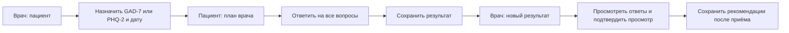

## Возвращение к дневнику и исправление

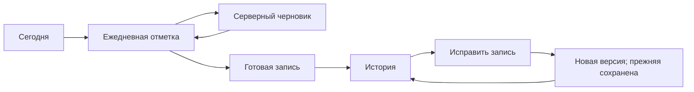

## Восстановление доступа

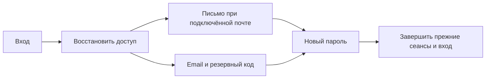

## Установка и уведомления

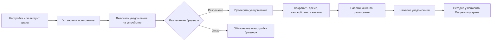

## Сведения о себе

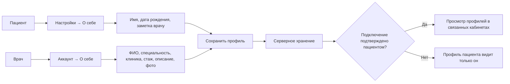

## Документы врача и подключение по коду

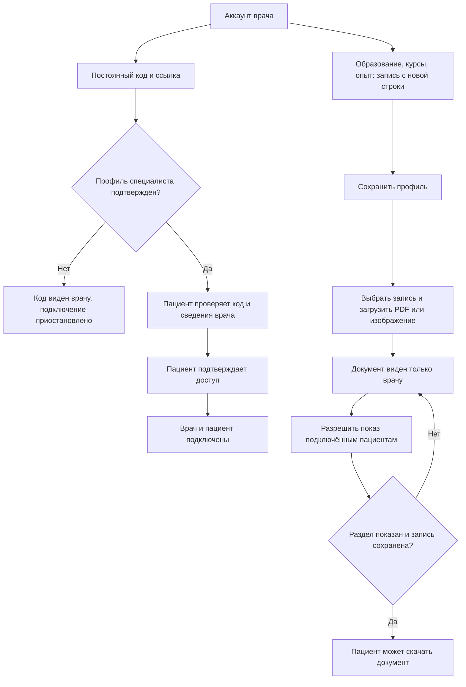

## Авторский опрос

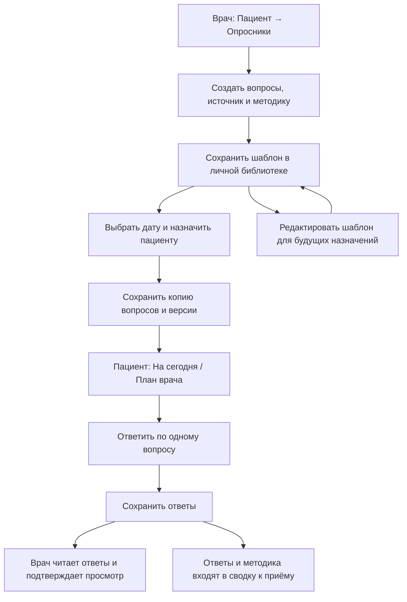

## Стандартные опросники

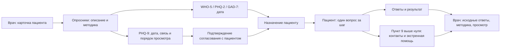

Описание и методика опросников: [Стандартные опросники](methodology/standard-assessments.md).

## Концепт и основные роли

[Как работает «Рядом»](PRODUCT-CONCEPT.md) описывает путь от ежедневной отметки до обсуждения с врачом. Кнопка подключения на странице «Сегодня» ведёт в `/settings/connect` прямо к разделу доступа, с фокусом и прокруткой.

## Личные цели и обратная связь

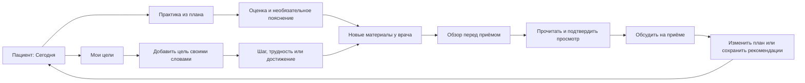

Завершение цели оставляет историю. Неприятный опыт отключает упражнение; подтверждение просмотра его не включает. Сводка сохраняет снимок целей и отзывов. Порядок просмотра согласуется с врачом, новая запись не обещает немедленного ответа.
